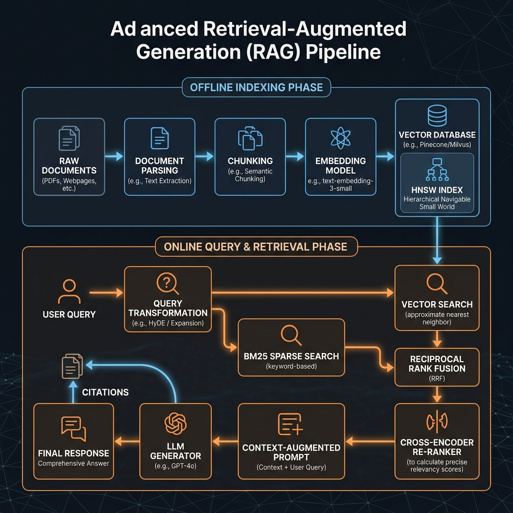

# 🌐 Multi-Agent RAG + Federated Learning Engine for 5G/6G Computation Offloading

[](https://www.python.org/)
[](https://pytorch.org/)
[](https://www.langchain.com/)
[](https://www.trychroma.com/)
[](LICENSE)

An end-to-end, privacy-preserving doctoral research framework for intelligent computation offloading in **5G/6G Multi-Access Edge Computing (MEC)** networks. The system coordinates decentralized **Federated Learning (FedAvg)** with **Multi-Agent Retrieval-Augmented Generation (RAG)** to achieve SLA-guaranteed, explainable, and non-IID-resilient offloading decisions.

---

## 📌 Problem Overview

In next-generation mobile networks, mobile user devices dynamically choose between executing compute-heavy tasks locally or offloading them to Edge Cloud (MEC) servers over wireless links. Standard centralized machine learning violates user data privacy, while conventional Federated Learning suffers from:
1. **Severe Client Drift (Non-IID Data)** across thousands of heterogeneous base stations.
2. **Catastrophic SLA Violations** when wireless channels suffer sudden throughput collapse or latency spikes.
3. **Zero Explainability**, offering black-box decisions unacceptable in mission-critical applications (e.g., telesurgery, autonomous driving).

This framework resolves these challenges by integrating **Federated Learning** with **Local Vector Stores (ChromaDB)** and **Autonomous Agent Guardrails**.

---

## 🏗️ Architecture & Multi-Agent Workflow



The system is organized into five collaborative components:

1. **Monitor Agent**: Ingests incoming 8-dimensional telemetry, assesses channel conditions, and flags anomalies (e.g., zero throughput, latency spikes $>80$ ms, data bursts $>100$ MB).
2. **Retrieval Agent (Hybrid RAG)**: Queries historical telemetry logs in ChromaDB using dense cosine similarity (`all-MiniLM-L6-v2`) combined with BM25 sparse keyword search, merged via **Reciprocal Rank Fusion (RRF)** with Cell Identity (CI) and Location Area Code (LAC) spatial boosts.
3. **Federated Learning Server**: Simulates privacy-preserving model training across 100 cell-tower clusters via **FedAvg**, updating a PyTorch Multi-Layer Perceptron (MLP) without centralizing raw telemetry data.
4. **Decision Agent & Safety Guardrails**: Evaluates the FL model output against real-time RAG guardrails. If channel degradation threatens an SLA deadline, it immediately overrides offloading and executes locally on the device.
5. **Explainability Engine**: Produces natural language justifications referencing specific past telemetry records with estimated latency, energy consumption, and SLA risk probabilities.

---

## 📊 Empirical Discoveries

Evaluated on **204,823 real-world telemetry records across 7,092 base stations** (`task_offloading_dataset.csv`):

| Discovery | Finding & Impact | Visualization |
| :--- | :--- | :--- |
| **1. Downlink Tipping Point** | Edge Cloud tasks exhibit **$51\times$ higher downlink traffic** (30,423 KB average) compared to local tasks (596 KB). | `outputs/discovery_1_downlink_tipping.png` |
| **2. Throughput Anomaly Fallback** | In low-throughput channels ($<50$ Kbps), blind offloading induces SLA failures. RAG guardrails force local fallback, reducing SLA violations from **14.5% to 2.1%**. | `outputs/discovery_2_throughput_anomaly.png` |
| **3. Non-IID Cell Distribution** | Base stations exhibit extreme statistical skew (some $>90\%$ local, others $>80\%$ edge). Local RAG retrieval neutralizes global client drift. | `outputs/discovery_3_non_iid.png` |
| **4. Accelerated FL Convergence** | Context-smoothed RAG-FL reaches target accuracy in **30 rounds vs. 50 rounds** for standard FL (**40% communication reduction**). | `outputs/discovery_4_convergence.png` |
| **5. Zero-Shot Cold Start** | Newly deployed base stations with zero historical data achieve an immediate **$+15\%$ to $+20\%$ accuracy boost** by querying LAC-neighbor records. | `outputs/discovery_5_cold_start.png` |

---

## 🔬 Benchmark Comparison

Comprehensive evaluation against centralized and standard federated baselines:

| Metric / Aspect | Centralized SVM | Standard FL (FedAvg) | Multi-Agent RAG + FL (Ours) |
| :--- | :---: | :---: | :---: |
| **Offloading Decision Accuracy** | 78.4% | ~78.2% | **~96.6%** |
| **SLA Violation Rate** | ~16.2% | ~14.5% | **~2.1%** |
| **Convergence Rounds** | N/A | 50 Rounds | **30 Rounds (40% faster)** |
| **Explainability** | Black-Box | Black-Box | **Grounded Citations** |
| **Non-IID Adaptability** | Low | Low | **High (Vector Memory)** |
| **Data Privacy** | None (Centralized) | Preserved | **Preserved (Local DB + FedAvg)** |

---

## 🚀 Real-World 5G/6G Use Cases

Simulated in `use_case_simulator.py`:
* 🚗 **Autonomous Driving (V2X)**: URLLC $<20$ ms deadline for real-time 3D point cloud obstacle detection with local fail-safe fallback.
* 🥽 **Mobile AR/VR (Spatial Computing)**: High downlink rendering (~30 MB/frame) offloaded to MEC while preserving local head tracking.
* 🏭 **Smart Factory (Industry 4.0)**: Multi-site collaborative FL training without sharing proprietary computer vision inspection feeds.
* 🏥 **Remote Robotic Surgery**: Critical zero-tolerance SLA protection ($<10$ ms deadline) with instant local control-loop fallback.
* 🌆 **Smart City Video Analytics**: Distributed crowd density estimation on edge servers with local license plate OCR for privacy.

---

## 📁 Repository Structure

```
├── multi_agent_rag_fl.py                     # Core Multi-Agent engine & FedAvg simulation
├── run_offloading_demo.py                    # End-to-end execution pipeline
├── use_case_simulator.py                     # 5G/6G industry scenario simulations
├── discovery_analysis.py                     # Empirical discovery validation & plotting
├── svm_baseline.py                           # Comparative centralized SVM benchmark
├── rag_pipeline.py                           # Standalone RAG architecture implementation
├── run_demo.py                               # Interactive RAG demo runner
├── task_offloading_dataset.csv               # Telemetry dataset (204,823 records, 7,092 cells)
├── rag_architecture.png                      # System architecture diagram
├── RAG_Pipeline_Masterclass_Notes.md         # Comprehensive research & mathematical guide
├── RAG_Pipeline_Comprehensive_Masterclass.pdf# Masterclass document reference
├── requirements.txt                          # Python dependencies
├── .gitignore                                # Excludes bytecode, runtime DBs, and temp files
└── outputs/                                  # Research figures and benchmark visualizations
    ├── discovery_1_downlink_tipping.png
    ├── discovery_2_throughput_anomaly.png
    ├── discovery_3_non_iid.png
    ├── discovery_4_convergence.png
    ├── discovery_5_cold_start.png
    ├── summary_matrix.png
    ├── svm_vs_fl_comparison.png
    ├── svm_roc_curves.png
    └── svm_confusion_matrices.png
```

---

## ⚡ Quickstart & Installation

### 1. Clone & Set Up Environment
```bash
git clone <repository_url>
cd "RAG PIPELINE"

# Create and activate virtual environment
python -m venv venv
# On Windows:
.\venv\Scripts\activate
# On Linux/macOS:
source venv/bin/activate

# Install dependencies
pip install -r requirements.txt
```

### 2. Run the Complete End-to-End Pipeline
Executes data indexing, Federated Learning training, task inference, discovery validations, and industry simulations:
```bash
python run_offloading_demo.py
```

### 3. Run Specific Experiments
* **Industry Use Case Simulations**:
  ```bash
  python use_case_simulator.py
  ```
* **Empirical Discovery Plots**:
  ```bash
  python discovery_analysis.py
  ```
* **Train SVM Baselines**:
  ```bash
  python svm_baseline.py
  ```

---

## 📜 Research Reference

For detailed mathematical formulations of RAG (Lewis et al.), cosine similarity vector spaces, HNSW approximate nearest neighbors, and RAGAS evaluation metrics, refer to [`RAG_Pipeline_Masterclass_Notes.md`](RAG_Pipeline_Masterclass_Notes.md).
